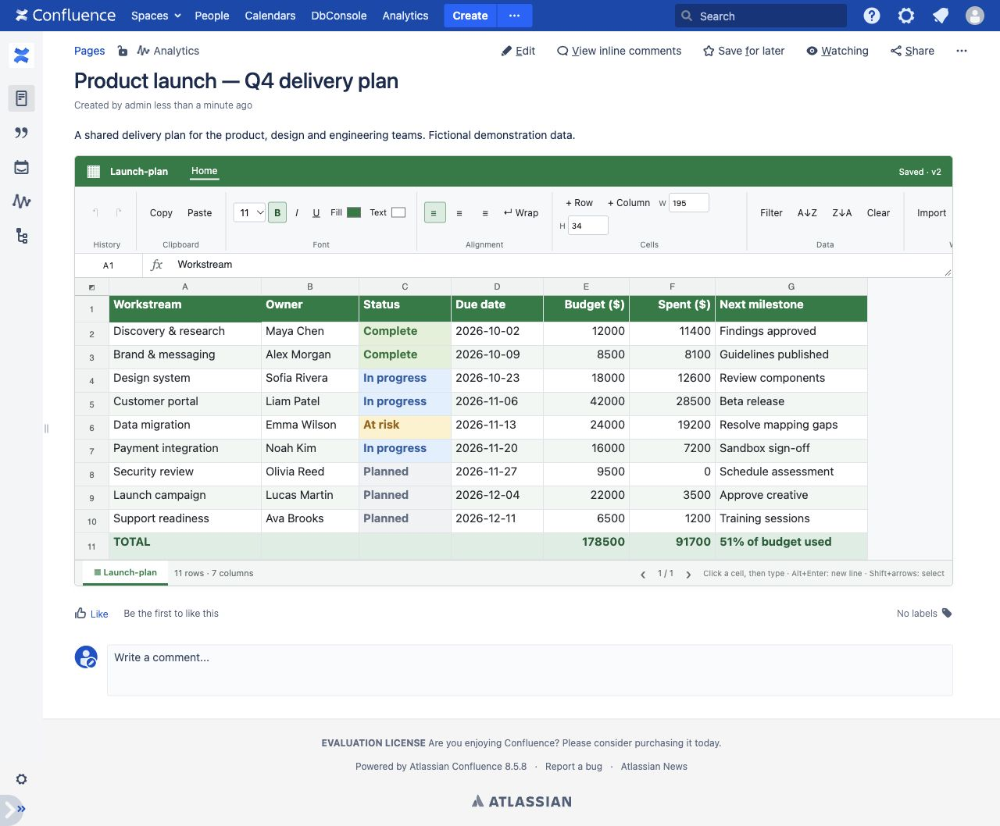

# Collaborative Sheets for Confluence Data Center

An Excel-style collaborative worksheet embedded in a Confluence page. Edit a shared plan, format cells, filter columns and exchange Excel/CSV files without leaving Confluence.

**Early development release.** Developed against **Confluence Data Center 8.5.8**, **Java 17** and **AMPS 9.9.1**. Other Confluence versions and Confluence Cloud are not currently supported or verified. This is an independent project, not an Atlassian or Microsoft product.



*Actual plugin UI in a local Confluence instance. All names and project data shown are fictional; totals in this example are stored values, not formulas.*

## Features

- **Spreadsheet editing:** select a cell and type, F2 to edit, Enter/Tab to navigate, Alt+Enter for multiline text.
- **Range selection and clipboard:** drag or Shift+arrow to select; copy/paste rectangular ranges, including Excel's quoted multiline fields.
- **Formatting:** bold, italic, underline, font size, text/background colors, alignment and wrapping.
- **Resizable rows and columns:** drag header boundaries or enter a size in the ribbon.
- **Personal sorting and filtering:** change your view without rearranging other users' data.
- **Excel/CSV import and export:** preview worksheets before replacing a table. XLSX supports basic formatting, dimensions and merged ranges; CSV carries values.
- **User-specific undo/redo:** Ctrl/Cmd+Z and Ctrl+Y / Cmd+Shift+Z, plus ribbon buttons. History survives reloads.
- **Confluence permissions:** viewers can read; only users with page editing permission can change data.
- **On-premises storage:** data lives in plugin-owned Active Objects tables within Confluence's database. AO manages schema creation; no separate database setup or manual SQL is required.

## Install

1. Download `sheets-confluence-dc-<version>.jar` from this repository's **Releases** section. Use the JAR asset, not GitHub's source-code ZIP.
2. Optionally verify it against the accompanying `.jar.sha256` file.
3. In a compatible test Confluence instance, open **Administration → Manage apps → Upload app** and select the JAR.
4. Edit a page, insert the **collaborative-sheet** macro and set its `sheet` parameter to a unique name, such as `launch-plan`.
5. Publish the page and click **Create sheet**, or import an XLSX/CSV workbook.

Use a different sheet key for every independent table on the same page. Reusing a key on that page displays the same table. Keys allow letters, numbers, hyphens and underscores (up to 64 characters). Existing Confluence tables are not converted automatically.

## Collaboration and data integrity

Writes use stable row/column identities, optimistic cell versions and a cluster-wide lock per sheet. Multi-cell changes commit atomically. Repeated requests with the same request ID do not apply twice. Permission checks run on the server and again after acquiring the write lock.

An immutable revision journal stores changes and periodic snapshots. AO commits the revision, request receipt and undo metadata together. Node-local caches are accelerators, not authoritative storage. Other users' changes are polled every five seconds; active editors are not silently overwritten.

Undo applies only to the current user's recorded action. If another user has since edited an affected cell or dimension, the whole undo is rejected with a conflict message. It never restores an entire old sheet over other users' work. Undo supports values, paste, formatting and dimensions. Import and row/column append are not undoable and clear the acting user's history. Sorting and filtering are personal view state and are not recorded in undo history.

Upgrade all cluster nodes together: mixed plugin versions and downgrades are unsupported. Validate in your staging environment and maintain tested Confluence/database backups before production use. The project has local two-node test experience, but does not claim certification or guarantees for database failover, network partitions or backup recovery. The latest undo/redo update was verified locally with two users, not rerun on two live nodes.

## Current limits

| Area | Current behavior |
| --- | --- |
| Size | Up to 9,999 rows, 200 columns and 200,000 grid positions per sheet |
| Batch editing | Up to 10,000 cells per operation; 100 displayed rows per page |
| Import | Up to 10 MB; replaces the selected table after preview |
| Merged cells | XLSX import/export supported; UI merge/unmerge and paste over merged ranges are not supported |
| Sorting/filtering | Disabled for sheets containing merged ranges |
| Formulas | No formula engine; formula/error cells are rejected on import |
| Excel fidelity | Basic styles and merges; not charts, images, themes or full workbook fidelity |
| Number formats | Retained for XLSX export; grid displays raw values, including Excel date serials |
| Structure | Append rows/columns; no deletion or insertion in the middle |
| Page lifecycle | Copy/move/trash workflows are not fully handled; copying a page does not copy AO data |
| Pending edits | Retried/downloadable while the page stays open; no durable offline queue |
| Revision retention | No pruning or general revision-restore UI yet |

## Build and test

Requirements: JDK 17, Maven 3.9.x and Node.js 22 (for clipboard tests). Maven resolves Confluence APIs and AMPS from Atlassian's public repository; no Confluence server is needed for unit tests.

```sh
mvn --batch-mode verify
node --test scripts/clipboard.test.cjs
```

The development JAR is `target/sheets-confluence-dc-0.1.0-SNAPSHOT.jar`. The Java suite currently contains 38 tests, including atomicity, conflict detection, request retries, rollback, permissions, workbook conversion and user-specific undo. Four clipboard parser tests cover rectangular and quoted multiline data.

To run a local development Confluence with the [Atlassian Plugin SDK](https://developer.atlassian.com/server/framework/atlassian-sdk/):

```sh
atlas-mvn confluence:run
```

The development instance uses `http://localhost:1990/confluence`. A valid test/evaluation license may be required. Generated instances, private fixtures, local load-test environments and reports are intentionally excluded from Git.

## Publish a release

The **Build and test** workflow runs on branch pushes and pull requests. The **Release plugin** workflow runs when a version tag is pushed. It sets the Maven and plugin descriptor versions from the tag, runs both test suites, validates the JAR and publishes a GitHub **prerelease** containing:

- `sheets-confluence-dc-<version>.jar` — installable Confluence plugin
- `sheets-confluence-dc-<version>.jar.sha256` — SHA-256 checksum

After publishing this repository to GitHub and enabling Actions:

```sh
git tag -a v0.1.0 -m "Collaborative Sheets 0.1.0"
git push origin v0.1.0
```

Tags such as `v0.1.0-rc.1` are also supported. Use a new tag for each release; the workflow does not overwrite existing release assets. No personal access token is needed: the release job uses GitHub's built-in token with repository contents write permission. The initial repository push alone does not create a release. Releases remain marked as prereleases while the project is at this maturity level.

## Contributing

Small, focused pull requests are welcome. Include regression coverage for changes to persistence, permissions, concurrency or workbook conversion. Run both test commands before submitting. Do not commit Confluence homes, database dumps, license keys, credentials or private workbooks. Use fictional data in examples and screenshots.

## License

[Apache License 2.0](LICENSE). See [NOTICE](NOTICE). Bundled libraries retain their own licenses and notices. Confluence itself is proprietary software and is not included in this repository or the plugin release.
